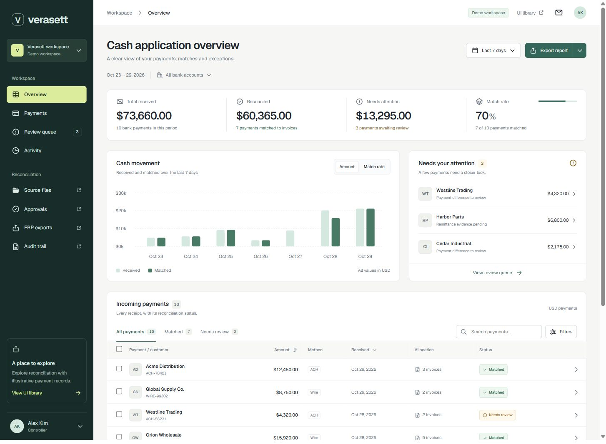
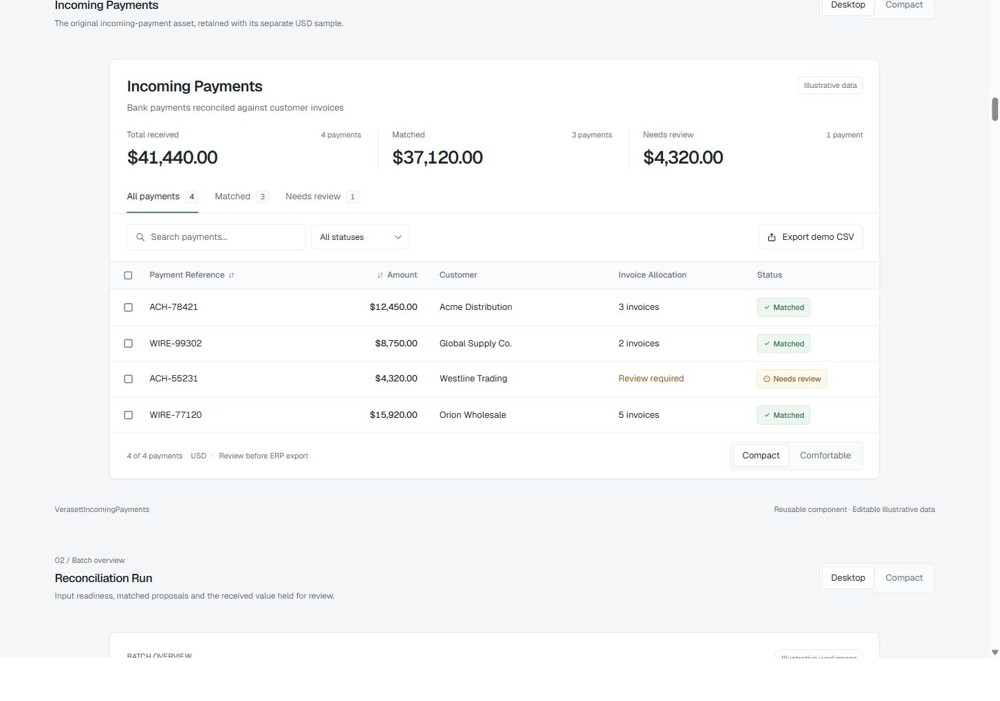
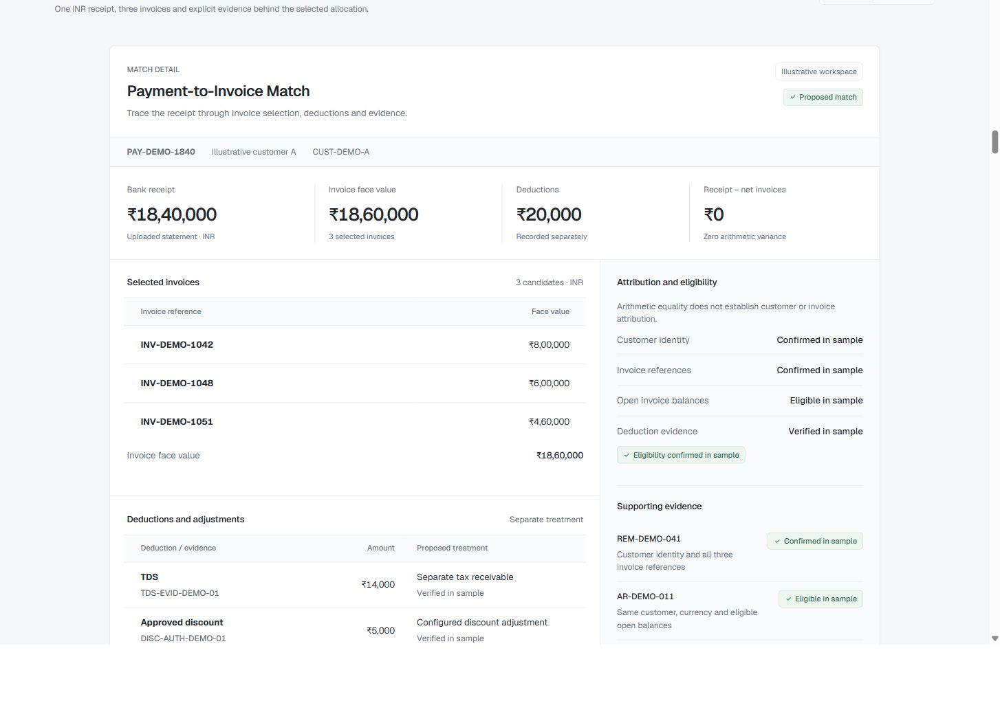
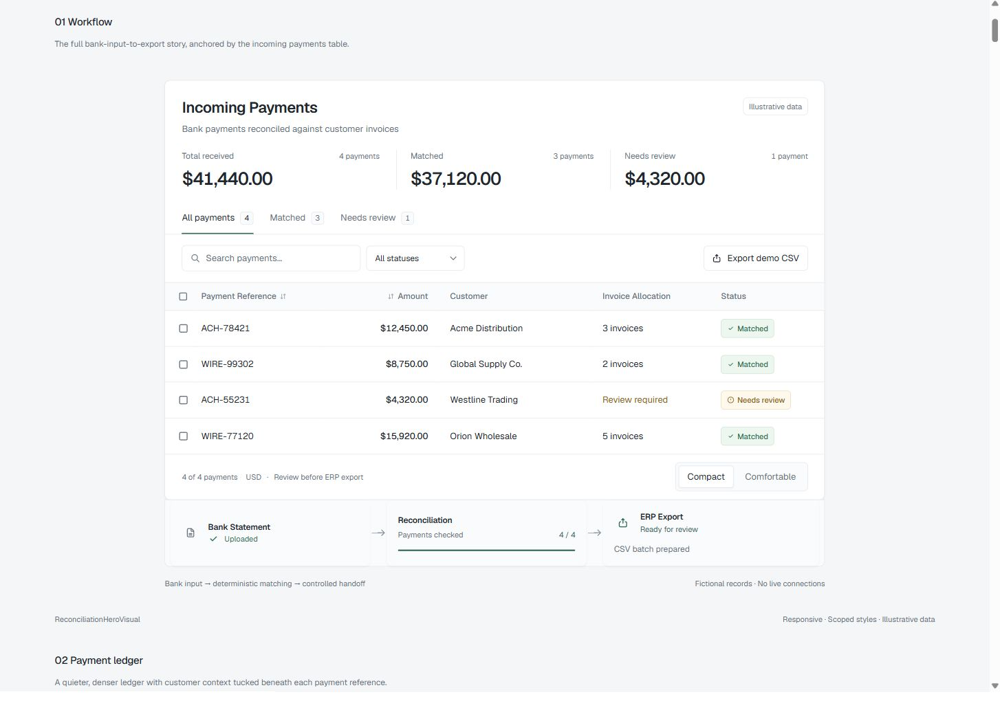
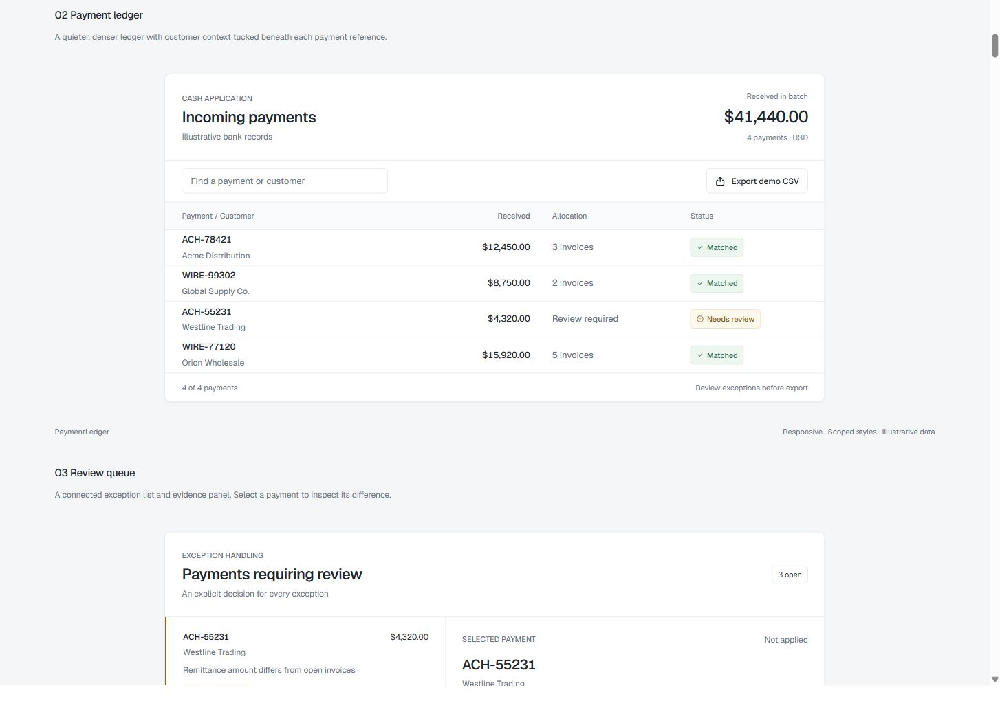
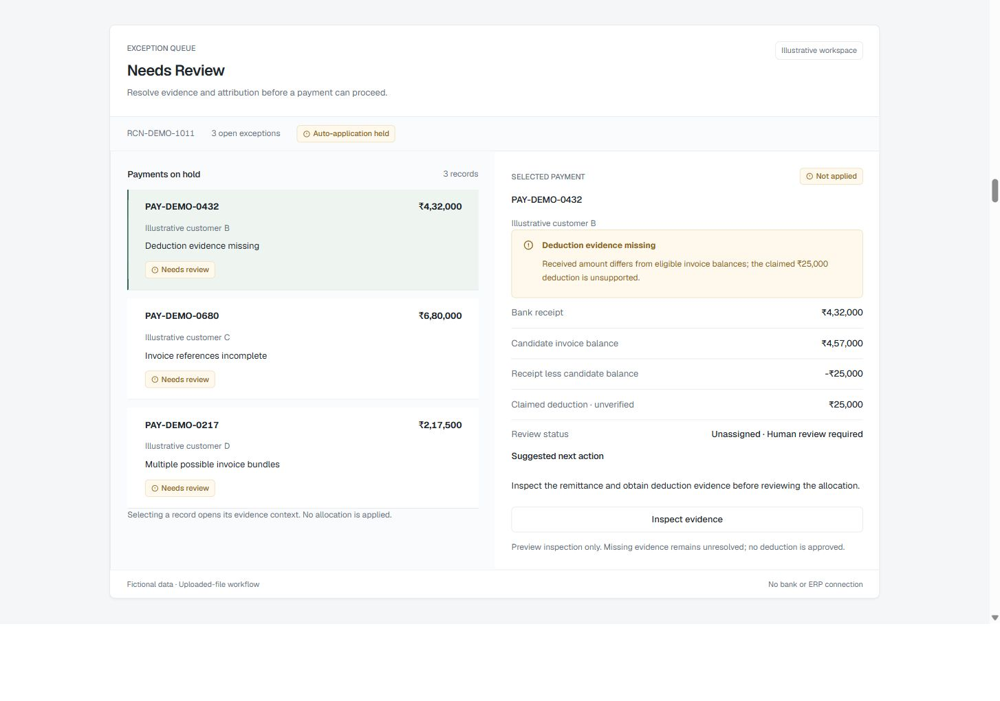
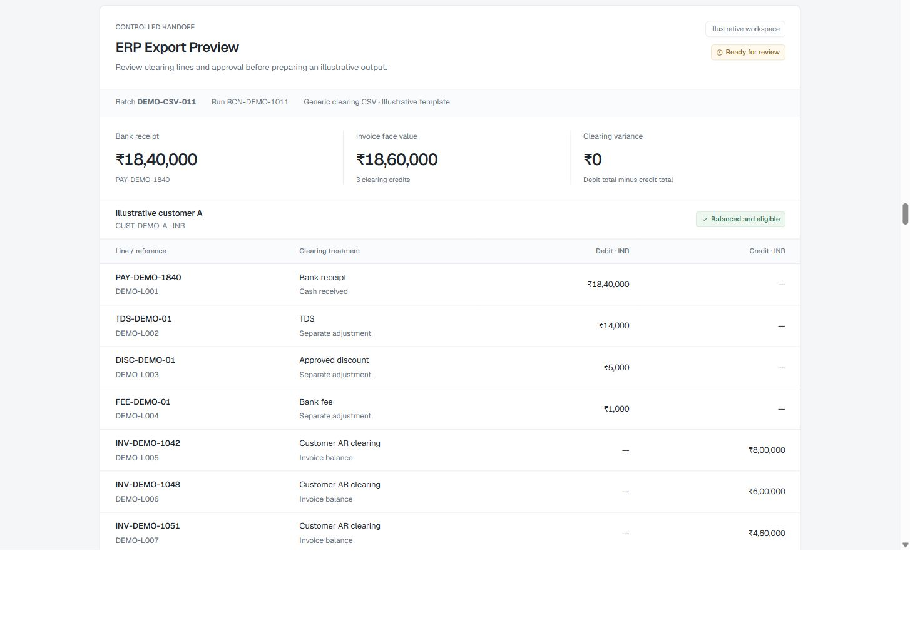
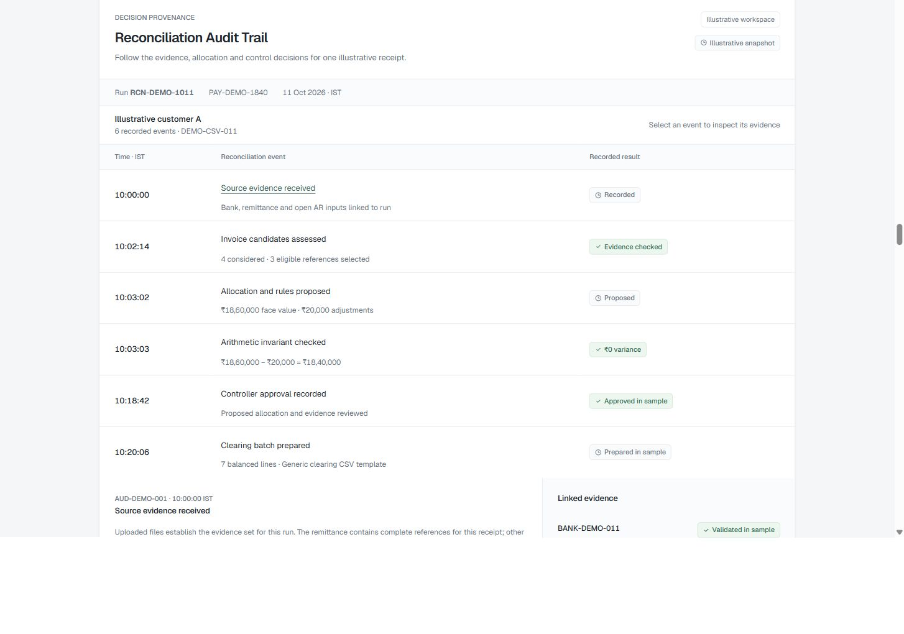

# Verasett UI — Premium V2

<p align="center">
  <strong>Enterprise Accounts Receivable (AR) Remittance Ingestion, Deterministic Cash Application & Bank Reconciliation Platform.</strong>
</p>

<p align="center">
  <a href="https://k39139215-gif.github.io/verasett-premium-v2/"></a>
  <a href="https://react.dev/"></a>
  <a href="https://www.typescriptlang.org/"></a>
  <a href="https://vitejs.dev/"></a>
  <a href="#license"></a>
</p>

### 🌐 Live Interactive Application Preview
👉 **[Click Here to Open Verasett Premium V2 Live App](https://k39139215-gif.github.io/verasett-premium-v2/)**
- 📊 **[Open Full Executive Dashboard](https://k39139215-gif.github.io/verasett-premium-v2/#dashboard)**
- 💳 **[Open Incoming Payments Screen](https://k39139215-gif.github.io/verasett-premium-v2/#screens/incoming)**
- 📑 **[Open Payment-to-Invoice Match Screen](https://k39139215-gif.github.io/verasett-premium-v2/#screens/match)**
- 🔍 **[Open Reconciliation Audit Trail Screen](https://k39139215-gif.github.io/verasett-premium-v2/#screens/audit)**

---

## 🖼️ Visual UI Screen Gallery

### 1. Executive Cash Application Dashboard
Interactive AR cash velocity chart, unapplied cash KPIs, auto-cleared transaction counters, review queue, and payment detail drawer.


### 2. Incoming Payments Operational Matrix
High-density payment reconciliation grid featuring multi-status filters, bank statement ingestion cards, and automated customer invoice mapping.


### 3. Payment-to-Invoice Match Engine
Deterministic multi-invoice matching interface with remittance OCR alignment, line-item deduction categorization, and confidence scoring.


### 4. End-to-End AR Workflow Composition
Continuous operational pipeline: lockbox ingestion, automated matching, short-pay exception review, and ERP posting.


### 5. Payment Ledger & Settlement Composition
Multi-entity clearing worksheet with debit/credit balance reconciliation and ledger line verification.


### 6. Exception Review & Short-Pay Deduction Triage
Deduction dispute workflow, reason-code tagging (trade spend, damaged goods, tax discrepancy), and controller approval gates.


### 7. ERP Export Staging & Immutable Audit Trail
Pre-flight posting simulation for NetSuite, SAP, and Workday, coupled with immutable timestamped audit logs.



---

## 🌟 Upgraded Inventory

- **Compositions:** Workflow Pipeline, Payment Ledger, Review Queue, Invoice Allocation.
- **Product Screens:** Incoming Payments, Reconciliation Run, Payment-to-Invoice Match, Remittance & Deductions, Exception Review, Controller Approval, ERP Export Preview, Reconciliation Audit Trail, Source Intake.
- **Alternative Layouts:** Allocation Matrix, Reconciliation Proof, Remittance Inbox, Close Readiness Board, Settlement Journal, Clearing Worksheet.
- **Component Primitives:** `IncomingPaymentsTable`, `BankStatementCard`, `MatchingProgressCard`, `ERPExportCard`, `PaymentMatchCard`, `ExceptionReviewCard`, `DeductionDetailCard`, `MatchMetric`, `StatusPill`, `WorkflowConnector`.
- **Workflow Tools:** `SourceFileDropzone`, `ReconciliationActivity`.

---

## 🎨 V2 Design System

- **Typography:** Self-hosted Geist font with tabular numeric sizing for precise currency alignment.
- **Color Palette:** Muted operational slate canvas, crisp white card surfaces, graphite typography, and semantic text indicators (verified emerald, warning amber, blocked crimson).
- **Design Tokens:** Defined in `src/components/verasett-ui-assets/tokens.css` (4px spacing scale, 8px container radii, 6px button controls, elevation shadows).
- **Mobile Responsive:** 44px minimum touch targets, horizontal scroll lock on tabular data with fixed reference column, and 16px form inputs preventing iOS zoom.

---

## 🛠️ Local Development & Build

```sh
# Install dependencies
npm ci

# Run development server (serves on http://127.0.0.1:5175/)
npm run dev

# Run unit & component tests (27 tests)
npm test

# Run linter
npm run lint

# Compile production bundle
npm run build

# Preview production build locally
npm run preview
```

---

## ⚖️ Intellectual Property & License

**Copyright (c) 2026 Kartik. All Rights Reserved.**

This repository and its source code are published for **viewing, evaluation, and portfolio demonstration purposes only**. No permission is granted to reproduce, distribute, modify, deploy, or commercially exploit this software.
